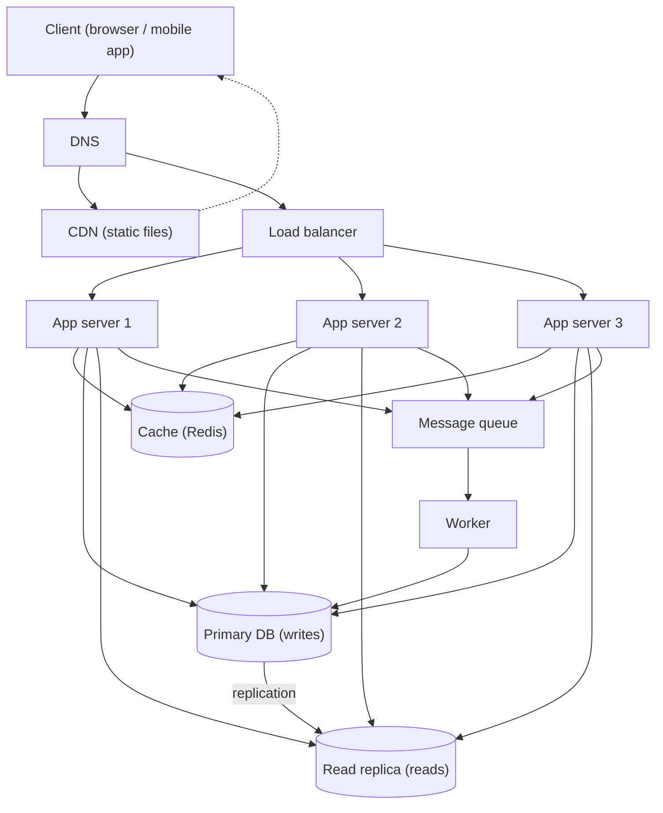

# QuickNotes Architecture

## Requirements

### Functional
- Users can register and log in.
- Users can create, read, update and delete notes.
- Users can list their notes (paginated) and organise them with tags.
- Users can only access their own notes.

### Non-functional
- **Scale:** 1 million registered users.
- **Availability:** 99.9% uptime; no single point of failure.
- **Latency:** `GET /notes` under 200 ms at p95.
- **Durability:** no note is lost once the API returns success (backups plus replication).
- **Security:** HTTPS everywhere, hashed passwords, per-user authorisation, rate limiting.
- **Scalability:** add servers without redesigning.

## Load estimate (1 million users)

Assumptions: 30% are active each day (300,000 daily active users), each loads their notes 10 times a day and creates 2 notes a day, a note is about 1 KB including metadata. Peak traffic is 10x the average.

| Metric | Calculation | Result |
|--------|-------------|--------|
| Reads per day | 300,000 x 10 | 3,000,000 |
| Reads per second (average) | 3,000,000 / 86,400 | about 35 reads/s |
| Reads per second (peak) | 35 x 10 | about 350 reads/s |
| Writes per day | 300,000 x 2 | 600,000 |
| Writes per second (average) | 600,000 / 86,400 | about 7 writes/s |
| Writes per second (peak) | 7 x 10 | about 70 writes/s |
| Storage per year | 600,000 x 365 x 1 KB | about 220 GB (about 330 GB with indexes) |

Conclusion: reads outnumber writes about 5 to 1, so caching and read replicas pay off. The volume is modest, so one primary database is enough; the design focuses on availability more than raw capacity.

## Architecture diagram



Plain-text version:

```
Client -> DNS -> CDN (static files)
             \-> Load balancer -> App server 1 / 2 / 3
                                    |-> Cache (Redis)
                                    |-> Primary DB --replication--> Read replica
                                    \-> Queue -> Worker -> Primary DB
```

## Components: the problem each one solves

- **Client:** gives users the interface and sends API requests.
- **DNS:** translates `quicknotes.example` into the address of the CDN or load balancer, so users never need an IP.
- **CDN:** serves HTML, CSS and JS from servers near the user, which cuts latency and keeps static traffic off the app servers.
- **Load balancer:** spreads requests across app servers and stops sending traffic to unhealthy ones.
- **App servers (3, stateless):** run the API logic; because they hold no session state, we can add or remove servers freely and one failure costs only a third of capacity.
- **Cache (Redis):** keeps hot data (recent note lists) in memory, so most reads skip the database and answer in milliseconds.
- **Primary database:** the single source of truth that accepts all writes with transactional guarantees.
- **Read replica:** serves read queries and holds a copy of the data, which offloads the primary and can be promoted if the primary fails.
- **Queue:** accepts slow or non-critical jobs immediately so the API can respond fast and absorb traffic spikes.
- **Worker:** processes queued jobs in the background (for example search indexing, sending emails, cleaning up deleted notes) and retries failures.

## Request flows

### GET /notes
1. The client sends `GET /notes?page=1` with its token; DNS resolves the host.
2. The load balancer picks a healthy app server.
3. The app server checks the token and finds the user id.
4. It looks up the key `notes:user:17:page:1` in the cache.
5. **Cache hit:** return the cached JSON with `200 OK` (done).
6. **Cache miss:** query the read replica (`WHERE user_id = 17 ORDER BY created_at DESC LIMIT 10`).
7. Store the result in the cache with a short TTL (for example 60 seconds).
8. Return `200 OK` with the JSON to the client.

### POST /notes
1. The client sends `POST /notes` with the JSON body and token.
2. The load balancer forwards it to an app server.
3. The app server authenticates the user and validates the body (title required, at most 100 characters); invalid input gets `400`.
4. It inserts the note into the **primary** database in a transaction.
5. It deletes the user's cached note-list keys so the next read is fresh.
6. It publishes a job (for example "index note 4821") to the queue.
7. It returns `201 Created` with the new note.
8. A worker picks up the job later and does the slow work (indexing, notifications) without delaying the user; the primary replicates the new row to the read replica.

## Trade-offs

1. **Caching vs consistency.** A cache makes reads fast but can serve stale data. We invalidate on writes and use a short TTL; users may rarely see a note list that is a few seconds old, which is acceptable for a notes app.
2. **Read replica vs strong consistency.** Replication lag means a read right after a write might miss the new note. Mitigation: read from the primary for a short time after the user's own write ("read your own writes").
3. **Queue vs simplicity.** The queue and worker make the API faster and more resilient but add a component to run and monitor, and background work is eventually consistent. We only queue non-critical jobs.
4. **SQL vs NoSQL.** SQL gives integrity and JOINs but scales writes vertically; at 70 writes/s peak that is fine, and sharding by `user_id` is the later escape hatch.

## Avoiding single points of failure

- **DNS and CDN:** use a managed provider with multiple points of presence.
- **Load balancer:** run two (active-active or managed multi-zone) behind one DNS name.
- **App servers:** three or more stateless instances across at least two availability zones; health checks remove failed ones automatically.
- **Cache:** Redis with a replica and automatic failover; if the cache is down, the app falls back to the database (slower but working).
- **Database:** the primary has a synchronous standby (the read replica in another zone) that is promoted automatically on failure, plus daily backups and point-in-time recovery.
- **Queue and worker:** a managed, replicated queue; several workers; failed jobs return to the queue and go to a dead-letter queue after repeated failures.
